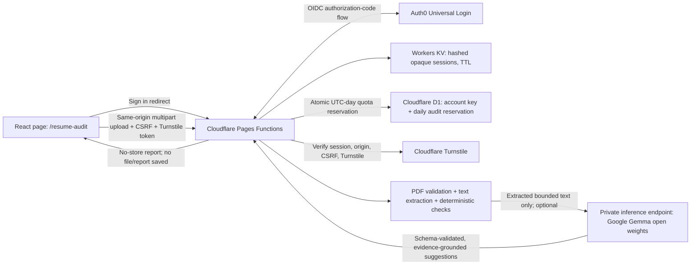

# Architecture and Implementation Plan: Public Résumé Audit

> Future implementation brief for GitHub Copilot. Read this plan together with `.github/copilot-instructions.md` before making code changes. Do not start implementation until the model-hosting and PDF-runtime feasibility gates in Phase 0 are resolved.

## Goal

Add a public `/resume-audit` page to gavrilov.ai. A visitor signs in with Google or Microsoft, uploads a PDF résumé, and receives one evidence-based ATS/readability and content-improvement report per UTC day.

The service is free to visitors, but model calls and PDF processing must be bounded. Never invent résumé facts or metrics. Résumé files, extracted text, and generated reports are transient and are not saved for later access.

## Current project context

| Area | Existing implementation |
|---|---|
| Frontend | React 19 + TypeScript strict + Tailwind CSS v4 + Vite; `App.tsx` handles pathname routing. |
| Hosting/API | Cloudflare Pages with Pages Functions under `functions/api/`. |
| AI | `functions/api/fit.ts` calls Gemini and has input checks, model timeouts, JSON parsing, and evidence grounding. **Do not reuse its Gemini model list** for this feature; this feature's AI, if used, must use Google open-weight Gemma models. |
| PDF | `pdfjs-dist` is installed and used by résumé text-check scripts. Those scripts run in Node; that does not prove PDF.js will fit the Cloudflare Workers runtime. Verify before implementation. |
| Existing admin auth | Cloudflare Access protects `/admin/` and `/api/admin/*`. Keep it exclusive to the private résumé editor; it is not the public sign-in system. |
| Existing privacy patterns | AI endpoints avoid logging request content and use `Cache-Control: no-store`; preserve and extend these patterns. |

## Decisions and constraints

1. **Authentication: Auth0 Universal Login with Google and Microsoft social connections.** Use a managed provider rather than implementing provider protocols, callback validation, and account linking directly. Verify both provider integrations and current Auth0 plan/pricing before committing to rollout.
2. **Server-owned session:** use a backend-for-frontend (BFF) flow. Pages Functions handle the OAuth authorization-code callback, validate state/nonce and tokens, and issue a random opaque session ID in a `Secure`, `HttpOnly`, `SameSite=Lax`, host-only cookie. Store only a hash of the session ID and minimal session metadata in Cloudflare KV with a short TTL. Do not put access or ID tokens in browser storage.
3. **Identity key:** use the verified Auth0 issuer plus `sub` as the stable account key. Do not key quotas or authorization to email; email can change and may not be verified uniformly across providers.
4. **Daily limit:** one successful audit per authenticated account per UTC calendar date. Enforce in D1 using a database uniqueness constraint and an atomic insert/reservation—not a client-side counter.
5. **No résumé persistence:** process the PDF in memory/request scope and discard it after producing the response. Do not upload it to R2, place it in D1/KV, or include content in logs/analytics. Do not save reports in the MVP.
6. **AI restriction:** if semantic AI feedback is enabled, call a Google Gemma open-weight model via a separately hosted inference service. Confirm the exact model, hosting path, license terms, provider retention, latency, and cost before enabling it. Model weights being open does not make hosted inference free.
7. **Deterministic first:** PDF integrity, extraction, geometry, glyph and formatting checks must be implemented as deterministic diagnostics. AI may provide semantic suggestions but cannot claim to verify low-level PDF properties.
8. **No OCR in MVP:** if a PDF has no usable text layer, explain that it appears scanned/unreadable and ask the user to upload a text-based PDF. Do not silently send page images to a model.
9. **User-facing scope:** findings are heuristic and ATS behavior varies by vendor. Do not promise an ATS pass, interview outcome, or universally accurate score.

## Architecture



### Trust boundaries

- The browser is untrusted. Never accept a user ID, quota status, extracted résumé text, or claimed PDF metadata from the client as authoritative.
- The PDF and any optional target-role text are untrusted input. Defend against malformed PDFs, prompt injection, oversized payloads, and unsupported claims.
- Auth0 is an identity provider, not an authorization decision from the browser. The Pages Function must validate the OAuth callback and session on every protected API request.
- The Gemma service receives extracted text only, not the original PDF or authentication/session data. Send only the minimum text needed for review.
- Logs, analytics, exception reports, and AI prompts must never contain a PDF, extracted résumé text, target-role text, report text, email, or raw provider error.

## Request and data flow

### Sign-in and session

1. The user selects Google or Microsoft on `/resume-audit`.
2. A same-origin Pages Function creates cryptographically random `state`, `nonce`, and PKCE verifier values, stores short-lived flow state server-side, and redirects to Auth0 Universal Login.
3. The callback validates state, exchanges the authorization code using PKCE, validates the ID token (signature, issuer, audience, expiry, nonce), and obtains the stable Auth0 subject.
4. The callback creates a cryptographically random opaque session ID. Store only its hash, subject, issue time, and expiry in KV. Set a `Secure; HttpOnly; SameSite=Lax; Path=/` cookie; use a `__Host-` cookie name in production.
5. Protected requests look up the hashed session ID server-side and reject expired/revoked sessions. Logout deletes the KV entry and expires the cookie.
6. Protect cookie-authenticated state-changing endpoints with exact same-origin `Origin` checks and a session-bound CSRF token. Never enable credentialed cross-origin CORS for these APIs.

### PDF audit

1. Browser obtains a fresh Turnstile token and posts one PDF plus an optional target role to the same-origin audit endpoint using `multipart/form-data`.
2. Function checks session, origin, CSRF, Turnstile through Cloudflare Siteverify, and a per-IP edge/rate-limit rule before reading or parsing the body.
3. Enforce request byte limit while reading (not only from `Content-Length`), allow only one file, require a `.pdf` filename as a convenience check, verify the `%PDF-` signature, and enforce page, text, processing-time, and extracted-character limits. Reject encrypted, malformed, empty-text, or unsupported files explicitly.
4. Extract text server-side. The client must not submit substitute extracted text. Run deterministic checks and build evidence references (page number and relevant text snippet) for each finding.
5. Atomically reserve the user's daily quota in D1 immediately before costly audit/model work. The unique constraint makes concurrent requests for the same account/day race-safe. Return `429` with a UTC retry time if a completed/reserved audit already exists.
6. Call Gemma only if the deterministic report needs semantic suggestions and the AI kill switch is enabled. Send bounded extracted text and optional role text; require a strict JSON schema. Validate all quoted evidence against the extracted text and reject any unsupported metrics or facts.
7. Mark the reservation successful and return the report with `Cache-Control: no-store`. Never cache the upload, extracted text, or report. If processing fails before a report is completed, release the reservation only with a conditional update/delete tied to that reservation ID; apply separate IP/request throttles so retries cannot become an unbounded cost path.
8. Clear client-held PDF/report state on explicit reset, sign-out, route exit, and page reload. Do not put it in local/session storage, analytics, URLs, or browser persistence.

### Daily quota model

Use D1 for quota accounting, not KV: the daily unique constraint and reservation state must be atomic.

Suggested initial schema (adapt to existing project conventions and test with D1 locally):

```sql
CREATE TABLE audit_usage (
  subject_key TEXT NOT NULL,
  quota_date TEXT NOT NULL,
  reservation_id TEXT NOT NULL UNIQUE,
  status TEXT NOT NULL CHECK (status IN ('reserved', 'completed')),
  created_at TEXT NOT NULL,
  completed_at TEXT,
  PRIMARY KEY (subject_key, quota_date)
);
```

- `subject_key` is a server-generated stable key derived from verified `issuer` + `sub` (for example, a keyed HMAC), not raw email.
- `quota_date` is the current UTC date in `YYYY-MM-DD`.
- Reserve with one `INSERT ... ON CONFLICT DO NOTHING`; inspect whether a row was inserted. Never implement “SELECT then INSERT” as the gate.
- Complete only when the report is ready. On a retriable internal failure, release only the matching reservation ID. Decide and document whether irrecoverable input/model failures consume a successful-audit allowance.
- Keep account/usage data minimal. Delete old usage records on a defined retention schedule after they are no longer needed for abuse prevention or operational support.
- Enforce an additional per-IP rate limit at Cloudflare edge/runtime. This is defense in depth, not the primary daily quota; IPs can be shared or change.

## API surface

All endpoints are same-origin Pages Functions. Exact paths can follow the existing routing conventions.

| Endpoint | Method | Purpose | Important controls |
|---|---|---|---|
| `/api/audit/auth/login` | GET | Start Auth0 OIDC authorization-code + PKCE flow; accept only `google-oauth2` and Microsoft connection identifiers configured in Auth0. | Allow-listed return paths; random state/nonce; short flow TTL. |
| `/api/audit/auth/callback` | GET | Validate callback, exchange code, create opaque session cookie. | State/nonce/PKCE, signature/issuer/audience/expiry validation, strict redirect allow-list. |
| `/api/audit/auth/session` | GET | Return minimal signed-in state and CSRF token; never return ID/access tokens. | No-store; same-origin session validation. |
| `/api/audit/auth/logout` | POST | Revoke session and clear cookie. | Same-origin, CSRF-protected. |
| `/api/audit/quota` | GET | Return whether today's quota appears available and next UTC reset. | Session required; advisory only—the POST reservation is authoritative. |
| `/api/audit` | POST | Validate, reserve quota, audit PDF, and return report. | Auth, Turnstile, CSRF, same-origin, bounded multipart parsing, IP/user limits, no-store. |

Do not expose a generic proxy endpoint to the model provider. Keep model host, model ID, API credentials, and prompt configuration server-side.

## Report contract

The public report should distinguish **measured result**, **heuristic signal**, and **not assessed**. Suggested sections:

1. **Readability and extraction:** pages, whether text is selectable/extractable, extraction warnings, and any scanned/unreadable-page limitation.
2. **Layout signals:** page geometry, suspicious multi-column ordering, margin placement, table-like grids, and possible page-break/orphan signals. Never treat a heuristic detector as proof of ATS failure.
3. **Fonts and character mapping:** report only what the parser can verify (for example, extracted font bytes, `/ToUnicode` mapping presence/count, ligature/PUA characters). Do not claim a mapping is correct merely because a CMap exists.
4. **Headings, dates, links:** quote exact findings and show the matched text. Missing a standard heading is a suggestion, not proof of unparseability.
5. **Content and keywords:** target-role alignment only when the user supplies a role. Do not claim universal ATS keyword scoring. Expand acronyms where useful, with evidence from the source.
6. **Writing improvements:** before/after suggestions grounded in the uploaded text. Use `[X%]`, `[$XM]`, or similar placeholders for missing numbers; never manufacture facts, metrics, employers, credentials, or outcomes.
7. **Scorecard:** rubric-based and versioned; show evidence and uncertainty. Avoid interview-lift statistics or unsupported claims.

The server validates response shape, list/item/character limits, allowed section IDs, evidence quotes, and absence of unsupported numbers. Invalid AI output must fail closed to a deterministic-only report or a clear temporary error—never a success-shaped empty report.

## Security, privacy, and operations

### Authentication and account abuse

- Configure Auth0 Universal Login with only Google and Microsoft connections, minimum required scopes, exact production/local callback URLs, and no broad wildcard callbacks.
- Validate OIDC state, nonce, PKCE, issuer, audience, signature, and token expiry. Pin allowed issuers/connection settings; do not treat a decoded JWT as verified.
- Rotate session IDs after login. Use Secure/HttpOnly/SameSite cookies, short session lifetimes, logout/revocation, CSRF protections, and server-side session expiry.
- Daily allowance is per Auth0 account, not per human. Users can create multiple provider accounts; describe the limit honestly. Turnstile and IP limits reduce abuse but cannot eliminate account farming.
- Never ask for email/profile scopes beyond what is required for login. Do not use email as the quota key.

### Upload and parser safety

- Start with a conservative byte cap (for example 5 MiB), page cap (for example 5 pages), extracted-text cap, and execution deadline; tune through tests and production metrics that contain no content.
- Treat MIME type, filename extension, and PDF signature as checks, not a complete security boundary. Parse with resource limits and reject unsupported/encrypted/malformed files.
- Benchmark PDF.js in the actual Cloudflare Pages Functions runtime, including WASM/worker setup and memory/CPU limits. If server-side extraction cannot run safely/reliably there, move only extraction to a tightly bounded isolated service; do not trust browser-extracted text.
- Do not run OCR in the first release. If added later, treat images as personal data, bound pages/resolution/time, and disclose any external processing.

### AI safety and reliability

- Google Gemma open weights do not guarantee free hosting. Compare a Google-supported hosted deployment with self-hosting only after pricing, regions, model availability, license, privacy/retention, latency, and concurrency are verified.
- Prefer a small text model that meets quality/latency needs; benchmark the actual résumé-report task with a redacted test set before launch.
- Use a strict JSON schema and low output token ceiling. Extracted résumé/target-role text is untrusted data; instruct the model not to follow embedded directions.
- Verify quotes and factual assertions against the extracted source after generation. AI may suggest edits but cannot establish PDF font embedding, byte-stream integrity, or exact layout.
- Use bounded timeouts, bounded retries (ideally no retry on non-transient errors), and an operator-controlled AI kill switch. A deterministic report should remain available if AI is disabled.

### Privacy, retention, and telemetry

- Update the public privacy/legal page before launch: describe Auth0, Google/Microsoft login, Gemma processing, what is sent to which providers, retention, deletion, and contact/rights process.
- Send extracted résumé text to the model only when required for the selected semantic features; do not send original PDF bytes.
- Do not log request/response bodies, authorization headers, cookies, file names, emails, résumé text, target-role text, report output, or raw provider errors.
- Analytics may record only coarse events (audit started/completed/failed, safe status category, model identifier, latency bucket). No document or report contents.
- Use `Cache-Control: no-store` on auth, quota, upload, and report responses. Do not persist report content in browser storage.
- Document that Auth0 and the inference host are third-party processors; review their current data-processing and retention terms.

## Phased implementation plan

### Phase 0 — Feasibility and product decisions (must precede code)

1. Confirm Auth0 supports the intended Google and Microsoft login configuration for this deployment; check current pricing, user limits, custom-domain requirements, callback URL requirements, and data-processing terms.
2. Choose the exact Gemma model and inference host. Confirm model license/terms, availability, pricing, region, request limits, retention, and realistic latency.
3. Build a small technical spike that extracts text from representative PDFs in the Cloudflare Pages Functions runtime using the installed `pdfjs-dist`. Test malformed, encrypted, image-only, large, multi-page, and two-column PDFs.
4. Establish limits from measured runtime behavior: maximum PDF bytes, pages, extracted characters, model input/output tokens, execution time, and concurrent requests.
5. Decide the report/quota policy: UTC reset; failed user-submitted/invalid PDFs; provider outage behavior; whether one completed report or one accepted attempt consumes the daily allowance.

**Exit criteria:** no unresolved uncertainty about safe server-side extraction, Auth0 session design, model endpoint, data processing, or spend bounds. If any gate fails, revise architecture before proceeding.

### Phase 1 — Schemas, bindings, and auth foundation

1. Add D1 migration for atomic daily quota reservations and minimal retention metadata.
2. Add KV binding for opaque server-side sessions and short-lived OAuth flow state.
3. Add environment typings and per-environment bindings/secrets; never add secrets to Vite client variables, tracked config, or source.
4. Implement Auth0 login/callback/session/logout Pages Functions with state, nonce, PKCE, token validation, and strict redirect allow-list.
5. Add auth/session helpers with explicit return types and no broad catches or silent fallbacks.
6. Add tests for invalid state/nonce, bad issuer/audience/signature/expiry, callback replay, cookie flags, logout, and missing configuration.

**Acceptance:** Google and Microsoft login work in local and deployed preview; unauthenticated API requests are rejected; tokens are never exposed to browser storage; admin Cloudflare Access remains unchanged.

### Phase 2 — Quota and abuse controls

1. Implement session-bound CSRF token and exact same-origin checks.
2. Add Turnstile to the upload flow and validate the token server-side with Siteverify (hostname/action validation where configured).
3. Add Cloudflare edge/runtime rate limits for per-IP bursts and D1 atomic per-account/day reservation.
4. Implement completion and conditional reservation-release behavior for failures; ensure concurrent requests cannot each start an audit.
5. Add quota status UI and UTC reset messaging; make POST reservation authoritative.
6. Add tests for concurrent reservation races, duplicate requests, UTC date boundary, user isolation, IP throttles, Turnstile replay/expiry/failure, and reservation cleanup.

**Acceptance:** at most one audit reservation per account per UTC day, including concurrent submissions; abuse limits work independently of the UI.

### Phase 3 — Deterministic PDF audit engine

1. Implement server-only request streaming/size bounds and PDF validation using findings from Phase 0.
2. Extract PDF text and page-level metadata in the Pages Function only if the runtime spike meets limits.
3. Implement pure, testable deterministic checks in shared utility modules (avoid DOM/Node-only APIs in modules imported by browser and Worker code).
4. Attach page/quote evidence and confidence/heuristic labels to each finding.
5. Return clear errors for unsupported, encrypted, malformed, image-only, too-large, or over-page-limit documents.
6. Add a representative, non-sensitive PDF fixture set; avoid committing any user's résumé or personal data.

**Acceptance:** all results are reproducible without AI; parser failures are explicit; the service never trusts client-provided extraction.

### Phase 4 — Gemma semantic feedback

1. Add a server-side adapter for the chosen Gemma endpoint with model configuration in server secrets/vars.
2. Send bounded extracted text and optional target role only; do not send PDF bytes or identity data.
3. Define and enforce a strict response schema; set input/output token limits and hard timeouts.
4. Validate every evidence quote and all numbers/names against the source text; reject unsupported facts and return deterministic-only output when appropriate.
5. Add prompt-injection, hallucinated-metric, malformed-JSON, timeout, provider-429/5xx, and oversized-output tests.
6. Add a kill switch and cost/latency dashboards using metadata only.

**Acceptance:** AI can be disabled instantly; deterministic analysis remains available; failed/invalid AI output cannot fabricate a report.

### Phase 5 — Public user experience, privacy, and launch readiness

1. Add `/resume-audit` to the existing pathname routing and reusable UI components.
2. Implement sign-in, upload validation/progress, accessible errors, quota display, report view, print styles, and clear/restart/logout actions.
3. Keep PDF/report only in transient component state. Clear on route exit/reset/logout/reload.
4. Update privacy/legal page, CSP/security headers, and public copy with upload limits, daily UTC quota, third-party processing, no-storage promise, limitations, and accessibility details.
5. Run type-check, lint, focused tests, full tests, build, and security/privacy review. Verify production/preview secrets and domain callbacks.
6. Release to a small beta, monitor failure rate and cost without content telemetry, tune limits, then launch publicly.

**Acceptance:** no raw PII in logs/analytics; exact configured daily quota works; safe failure behavior and operational kill switches are tested; the page works on mobile and with keyboard/screen-reader navigation.

## Suggested file map

Keep the implementation focused; exact paths may change to fit existing patterns.

```text
components/ResumeAudit.tsx                 # Public page flow and report rendering
hooks/useResumeAudit.ts                    # Upload/session/quota state and cancellation
types.ts                                    # Shared, minimal report and API types
functions/api/audit.ts                     # Authenticated upload, quota reservation, audit response
functions/api/audit/auth/login.ts           # OIDC start
functions/api/audit/auth/callback.ts        # OIDC callback
functions/api/audit/auth/session.ts         # Session state + CSRF token
functions/api/audit/auth/logout.ts          # Revocation and cookie expiry
functions/api/audit/quota.ts               # Advisory quota status
utils/resumeAuditLimits.ts                  # Shared non-secret size/content limits
utils/resumeAudit.ts                        # Pure deterministic checks / schema guards as appropriate
functions/api/audit/auth.ts                 # Worker-only session/token helpers (do not import to browser)
migrations/                                 # D1 schema migration if repo adopts migrations here
tests/resumeAudit*.test.ts                  # Validator, quota, API, report grounding, UI tests
```

Never import `admin/` code into the public app. Keep provider secrets and Worker-only helpers out of the Vite public bundle.

## Configuration and operational checklist

- Auth0: tenant/domain, client ID/secret, exact callback/logout URLs, Google and Microsoft connections, allowed origins, audience/API if used.
- Cloudflare Pages: D1 binding, KV binding, Turnstile secret, Auth0 server secrets, Gemma endpoint/credential, AI enable flag, per-environment values.
- Production and Preview must use separate OAuth callbacks, databases/usage data, and secrets. Do not enable a broad `*.pages.dev` production path.
- Security headers: update CSP only for actual required origins; preserve `frame-ancestors 'none'`, `object-src 'none'`, `base-uri 'none'`, and no-store behavior for sensitive API output.
- Monitoring: record outcome category, HTTP status, model identifier, latency, and quota counts only. Alert on cost, provider failures, parser failures, and unusual request rates.
- Rollback: disable AI first, then disable upload endpoint with a clear maintenance response; keep sign-in/logout and existing portfolio/chat/admin features unaffected.

## Definition of done

- Google and Microsoft sign-in are server-validated and session-protected.
- A user can receive no more than one completed audit per UTC day; D1 uniqueness handles concurrent requests.
- Per-IP rate limiting and server-verified Turnstile provide independent abuse controls.
- PDFs are size/page/time bounded, parsed server-side, and never persisted or logged.
- Deterministic findings show evidence and uncertainty; AI feedback uses only Google Gemma open weights and is evidence-grounded.
- Unsupported PDFs and unavailable model services fail explicitly and safely.
- Privacy, retention, provider processing, limits, and ATS limitations are clearly disclosed.
- Type-check, lint, tests, and production build pass; no unrelated worktree changes are staged or reverted.

## Reference documentation

- [Cloudflare Pages Functions](https://developers.cloudflare.com/pages/functions/)
- [Cloudflare D1](https://developers.cloudflare.com/d1/)
- [Cloudflare Workers storage options](https://developers.cloudflare.com/workers/platform/storage-options/)
- [Cloudflare Turnstile server-side validation](https://developers.cloudflare.com/turnstile/get-started/server-side-validation/)
- [Google Gemma documentation](https://ai.google.dev/gemma/docs)
- [Auth0 Google social connection](https://auth0.com/docs/authenticate/identity-providers/social-identity-providers/google)
- [Better Auth Google provider](https://www.better-auth.com/docs/authentication/google) and [Microsoft provider](https://www.better-auth.com/docs/authentication/microsoft) (alternative only; not the default architecture in this plan)
